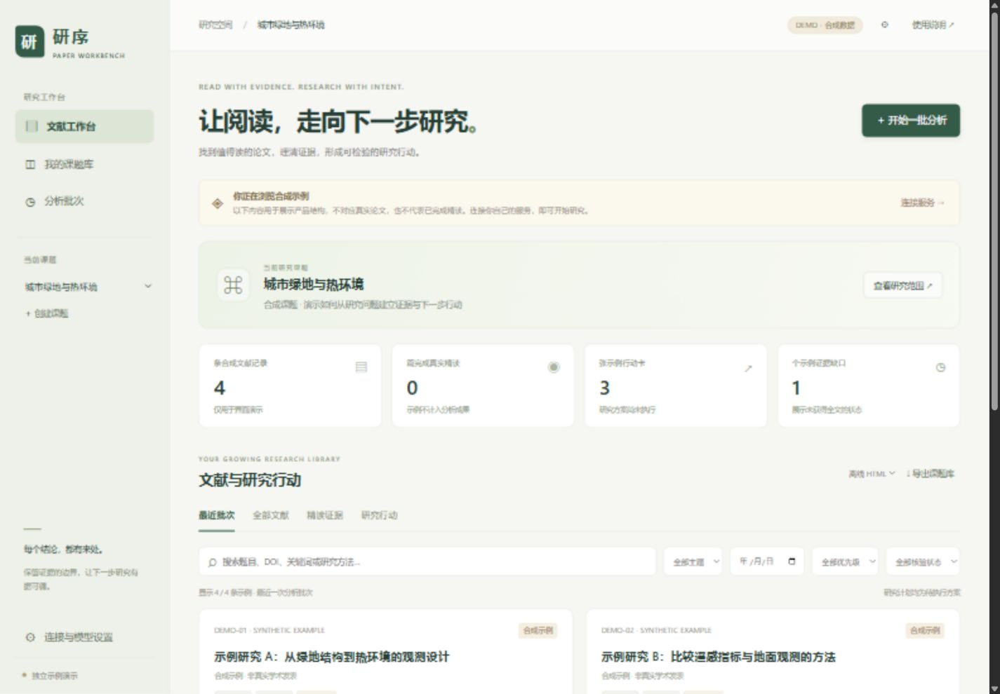

# 研序 Paper Workbench

一个按课题持续积累论文、精读证据和可检验研究行动的开源研究工作台。

用户通过浏览器操作，不需要安装软件。部署者将静态前端发布到 GitHub Pages，并另行部署私人分析后端。项目不含真实私人课题、论文库、API 密钥或第三方 Norman 技能。

访问[在线网页与合成演示](https://jennie35.github.io/paper-workbench/)，或查看 [GitHub 源码](https://github.com/jennie35/paper-workbench)。已启动本机服务的电脑可打开[本机看板](http://127.0.0.1:8095/)；这个地址只连接当前电脑，不是公网后端。



## 已实现

- 输入课题名称、研究目标，或上传参考 PDF；提取并编辑研究范围。
- 首页提供课题入口；进入课题后，在「文献与研究行动」「分析批次与结果」之间切换。
- 按批次检索 Crossref / OpenAlex，默认 5 篇，可选 1–20 篇。
- 按课题相关性、发表状态和年份筛选；DOI、规范化标题、作者和版本关系去重。
- 全文身份检查、来源映射、全文分段分析、原始页面视觉核验、结论修正和原生结构校验。
- 科学问题、研究设计重建、证据卡、原图、必要公式、精读清单、未来启示与待执行研究行动。
- 后台检查点、取消、失败恢复、补充正文 PDF、长期唯一编号与跨课题证据复用。
- 登录保护、加密模型配置、文件鉴权、HTTPS 下载与内部地址拦截。
- Markdown、JSON 和包含图片的离线 HTML 文献库导出。
- 无需后端即可浏览的合成示例；示例不调用模型，不冒充真实精读。

## 架构

```text
GitHub repository ── GitHub Actions ── GitHub Pages
                                            │ HTTPS + Bearer session
                                            ▼
                                       FastAPI API
                                       │        │
                                PostgreSQL   Redis / RQ worker
                                                │
                            Crossref / OpenAlex / model API
                                                │
                          external Norman skill + native engine
                                                │
                                    private persistent files
```

前端是静态应用外壳，私人数据由后端 API 提供。Pages 本身不执行分析。关闭浏览器不会取消后台任务。

## 本地看示例

要在自己的电脑实际创建课题、上传和保存资料，可使用[本机使用方式](docs/LOCAL.md)：维护者启动 `python backend/run_local.py` 后，浏览器访问 `http://127.0.0.1:8095/`。此模式不需要 Redis 或 Docker；自动分析仍需配置模型接口。

首页只显示课题入口。点击「进入课题」，再从该课题的「分析批次与结果」查看进度，或从「文献与研究行动」浏览实际完成的文献、候选和未核验草稿。缺全文或核验失败不会计入完整精读；「返回课题首页」可打开其他课题。详见[批次结果与草稿阅读](docs/RESULTS.md)。

部署者可在仓库根目录运行以下命令预览界面，普通在线用户不需要执行：

```sh
python -m http.server 8080 --directory frontend
```

访问 `http://localhost:8080`。直接通过 `file://` 双击开发版首页可能受 ES Modules 限制；后端导出的离线 HTML 包则可以双击打开。

## 发布 GitHub Pages

1. 在自己的 GitHub 账号创建空仓库 `paper-workbench`，将本目录内容提交到 `main`。
2. 仓库 Settings → Pages → Source 选择 **GitHub Actions**。
3. 推送 `frontend/` 后，内置 Pages 工作流发布静态前端。
4. 打开工作流返回的 Pages 地址。所有资源使用相对路径，支持仓库子路径。
5. 在网页点击“连接服务”，填写自己的后端 HTTPS 地址和管理员口令。

只有 `frontend/` 会被 Pages 工作流上传。不要把 `.env`、私人数据或外部技能复制进去。

## 部署后端

详见 [部署与运维](docs/DEPLOYMENT.md)。需要 Docker Compose、一个 HTTPS 入口、模型 API、外部 Norman 技能及其原生运行环境。

**平台边界：当前外部 Norman 1.4.0 原生引擎支持 Windows/macOS，不包含 Linux 引擎。** Linux Docker 部署需连接本项目提供的原生引擎桥接服务。不能只挂载技能目录就假定 Linux 能执行 Windows EXE；没有有效引擎时，分析预检会失败。

```sh
cp .env.example .env
# 编辑 .env，设置随机口令、加密密钥、Pages origin 和外部技能路径/桥接服务。
docker compose up -d --build
```

网页登录后，在「连接与模型设置」填写模型基础地址、当前供应商的密钥、文本模型、视觉模型及可选 OpenAlex 密钥。「仅保存配置」不调用模型；可选的「保存并检查接口」会先保存当前表单，再实际调用文本与图像模型，可能产生 API 费用。开始分析批次时，后台会自动预检，无须先手动检查一次。

同一 API 来源下，密钥留空可保留原值；更换供应商地址后必须填写对应的新密钥。配置发生变化会撤销旧的接口检查状态。网页服务地址、模型 API 地址和 GitHub 仓库地址用途不同，请分别填写。

兼容接口必须支持 `/chat/completions`、`messages`、文本 JSON 回答和 PNG data URL 图像输入；不同供应商支持程度不同。没有图像能力不能完成精读额度。

## 研究流程与可信度

上传的 PDF 默认界定研究范围，不占论文额度。系统先找近两年的候选，不足时扩展到近五年及更早；没有可靠新论文时如实报告缺额。

“已模型核验”表示模型读取了来源文本及选定原始页面，并通过结构校验，不表示独立人工复核或实验复现。文献、引用次数和发表状态不直接证明结论正确。摘要、下载链接和成功渲染都不等于完成精读。

同篇论文不重复作为新增：已有记录跨课题复用时明确提示，当前课题适用性仍需重新评估。无法取得全文的候选可在详情中补充 PDF，页面持续显示已保存状态。点击「继续整个批次」并确认后，后台处理本批剩余候选，沿用原批次范围与当前模型配置，可能产生 API 用量；正文替换会保留旧分析材料，不混用旧检查点。

主要图表用原始整页图保留坐标、子图、图注与脚注。图像不清晰、必要补充资料缺失或模型报告未读内容时不标记完成。样本量、阈值无依据时必须留待先导实验确定。

## 开发与测试

```sh
python -m venv .venv
# 激活虚拟环境后：
pip install -r backend/requirements-dev.txt
pytest backend/tests -q
node --check frontend/app.js
node --test frontend/tests/*.test.mjs
```

默认测试使用隔离的 SQLite 临时库与模拟模型，不需要密钥，也不会读取私人文献。生产使用 PostgreSQL 行锁和唯一约束。测试覆盖与未验证事项见 [验收记录](docs/VALIDATION.md)。

API 入口和数据接口见 [接口说明](docs/API.md)。通过 `/docs` 可查看运行实例的 OpenAPI 文档；数据操作仍需登录令牌。

## 许可与依赖

原创代码采用 [MIT](LICENSE)。Temml 用于在浏览器本地将 LaTeX 转换为 MathML，其许可及字体通知保存在 `frontend/vendor/`。后端 Python 依赖列于 `backend/requirements.txt`。

Norman Paper Reading 为外部依赖，项目不复制、下载或重新许可其规则、工具和二进制。部署者自行提供合法可用的技能目录。完成的分析保留技能要求的双语署名。论文、原图及用户资料保留各自许可，不随项目代码改用 MIT；公开分享研究资料前应逐项检查许可与公开范围。

本项目首版面向单人私人部署，不提供公开注册、多人协作、自动定时分析或自动公开论文库。
