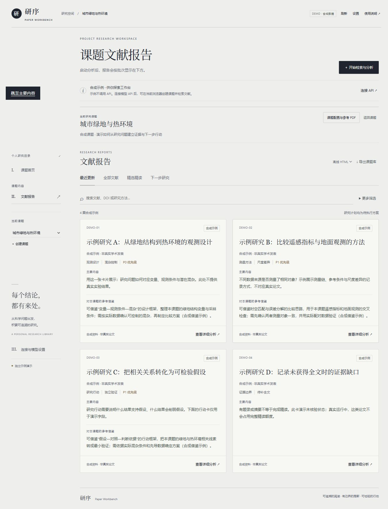
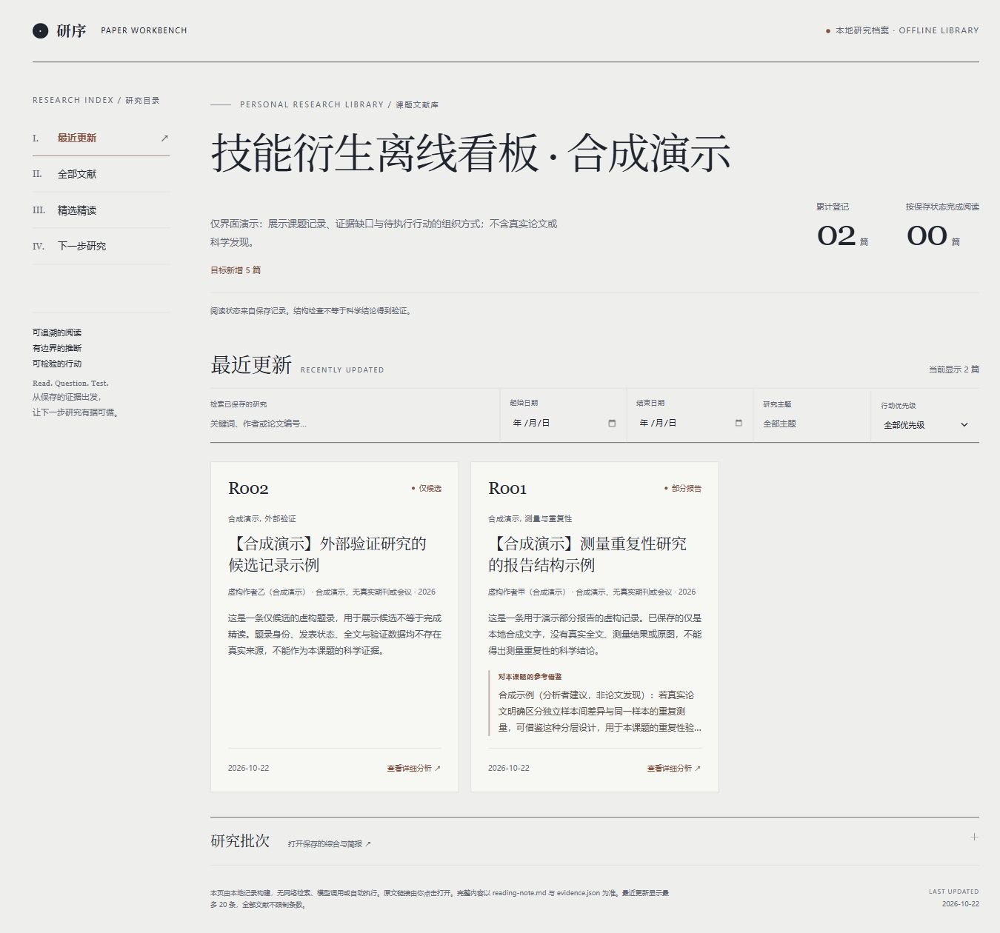

# 看板设计说明

本次设计参考 Anatolii Tsybulskii 的 [The National Electronic Library — UX/UI](https://www.behance.net/gallery/120566943/The-National-Electronic-Library-UXUI) 及用户提供的截图，提取目录、排版和留白的设计方法。页面代码与研究内容采用本项目自己的实现，未复制参考作品中的人物照片、馆藏封面、标志或字体文件。

## 参考设计的特点

- **以排版建立层级。** 大号衬线标题承担视觉重心，小号无衬线文字承担导航、来源与操作。用户先辨认页面主题，再读取条目细节。
- **目录式导航。** 罗马数字、细分隔线与侧栏形成稳定定位，当前入口通过文字、分隔线和箭头共同指示。
- **克制的灰阶。** 灰白底色、深色文字和轻分隔线让内容成为主体。参考中的描边数字与不对称图片增强版面节奏。
- **宽松且不对称的网格。** 主标题、说明和图片各有阅读区域，留白用于分隔层次。它适合图书馆介绍页；用于科研工具时需要压缩非必要的空白，保持研究操作可发现。

## 在研究看板中的转化

| 设计方法 | 本项目实现 | 对研究操作的作用 |
| --- | --- | --- |
| 大标题和衬线字 | 课题页、文献题名与阅读章节采用本地衬线字体；按钮和表单保留无衬线字 | 区分阅读内容和操作入口 |
| 数字目录与描边数字 | 左栏使用 I / II / III；首页数字来自实际加载的课题数量 | 提供位置感，不使用虚构的统计 |
| 细线分区 | 课题入口、检索栏、文献条目和阅读章节用细线建立层次 | 减少圆角卡片和背景色块的堆叠 |
| 不对称排版与卡片网格 | 首页采用标题与数量分栏；文献采用响应式方块网格，卡片显示主要内容、对本课题的参考借鉴与阅读入口 | 同时扫描编号、题名、来源和状态 |
| 灰阶与少量强调色 | 主体使用灰白和墨色；实际核验状态与运行错误使用文字标签及状态色 | 保持证据边界清晰，颜色不承担唯一含义 |

## 页面与交互

首页只展示课题入口、创建操作及连接说明。分析批次、文献报告、跨论文综合和行动保留在课题内部。四个报告视图、筛选、导出、删除确认与 PDF 参考资料流程保留。每次搜索以“目标新增 x 篇”为目标，跳过已分析记录；页面展示实际新增数，不设置复用或缺额计数块。

卡片以主要内容和“对本课题的参考借鉴”帮助横向比较，点击后进入详细分析。阅读详情采用宽版阅读区、侧栏目录、衬线章节标题和可定位的证据区。空字段与无分析内容的章节不展示，目录也只列实际章节。开头简要保留实际资料范围与核验状态；已分析出的局限继续展示，界面变化不提高阅读或核验等级。

手机端将侧栏压缩为横向导航，文献卡片调整为单列，长表单和阅读详情在对话框内滚动。长标题可以换行，公式保留横向滚动；提供键盘焦点和跳至主要内容入口。

主网页的主题位于 [`frontend/editorial.css`](../frontend/editorial.css)，沿用原有交互状态样式。网页离线导出与 Skill 本地生成器采用相同的卡片阅读方式，内嵌独立样式；主目录离线页无外部字体、脚本或自动网络依赖。

## 演示与验证范围

- [主工作台](https://jennie35.github.io/paper-workbench/)和 [Skill 离线演示](https://jennie35.github.io/paper-workbench/demos/skill-offline/)均使用明确标注的合成资料。
- 预览图来自实际浏览器渲染，手机检查使用 390 × 844 的视口。
- 自动检查覆盖原有前端行为、离线生成保护及合成来源的一致性；浏览器检查覆盖课题入口、搜索、视图、阅读详情、连接表单和移动布局。
- 本次仅更新界面、生成模板和说明，没有发起论文分析、调用付费模型或修改私人课题资料。

